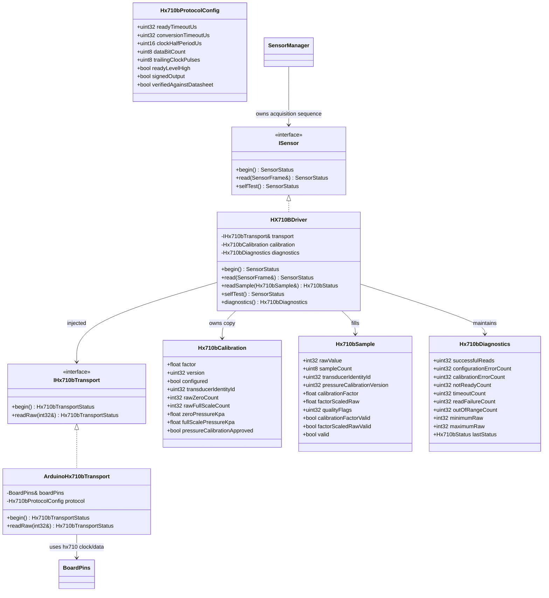

# HX710B driver

## Class diagram

## Scope and physical-quantity boundary

The driver exposes the ADC converter raw count, optional calibration factor,
factor-scaled raw count, read quality, and diagnostics. It never writes
`SensorFrame::hx710bCalibratedValue`. `factorScaledRaw` means only
`rawValue * calibrationFactor`; it must not be treated as a calibrated
engineering measurement.

This follows the system documents: the transducer, wiring, zero/span, range and
measurand have not been selected. Do not feed this channel into a physical
feature, model, or risk policy until the transducer and calibration evidence
are reviewed and the data contract is updated.

## Transport and configuration

`ArduinoHx710bTransport` reads the clock/data pins from `BoardPins::hx710`;
there are no driver-local GPIO assignments. Configuration is accepted only
for signed 24-bit reads and exactly 25 trailing clock pulses, with distinct
configured pins, datasheet verification, and nonzero ready/conversion
timeouts no greater than 200 ms. The caller must still verify HX710B variant
timing and polarity for the actual module. All polling and conversion waits
are bounded and wrap-safe. Sign extension maps the 24-bit two's-complement
value into the signed 32-bit raw range. This synchronous path belongs in task
context, never an ISR.

`HX710BDriver::readSample()` attempts at most three conversions and averages
only successful, in-range values. A valid partial average includes its actual
sample count and is marked degraded; if all conversions fail, the sample and
`SensorFrame` output remain cleared/invalid rather than reusing a previous
pressure value. The raw average remains available even when no transducer
profile is approved.

Calibration is optional so raw acquisition and diagnostics remain available
before transducer selection. When configured, a finite nonzero factor and
nonzero calibration version are required for the factor to be marked valid.
Invalid/unset calibration does not suppress a valid raw conversion; it is
reported in quality flags and diagnostics. A configured valid factor produces
`factorScaledRaw` without assigning it a physical unit.

## Diagnostics and frame integration

`Hx710bDiagnostics` maintains saturating success, not-ready, conversion-timeout,
transport failure, configuration-error, calibration-error, and range-error
counters, last status,
calibration-factor availability, and observed raw min/max. Quality flags
distinguish valid raw data, valid factor, unavailable calibration, invalid
calibration, valid factor-scaled raw output, and factor-scaling overflow. Raw
zero is permitted when the sample validity flag is true.

The adapter forwards the driver result to `SensorFrame`; it leaves the
legacy `hx710bCalibratedValue` field untouched. `SensorManager` preserves raw
sample count, approved transducer identity, and pressure-calibration version
in its immutable snapshot. Diagnostics are available from the driver instance
and should be collected by the owning diagnostics task. One `TaskSensor` owner
is expected; no internal mutex is used.

## Approved pressure and baseline boundary

Only `CalibrationService` may map HX710B raw counts to kPa. Its optional
in-memory profile is active only when approval, verified transducer identity,
verified range, nonzero version, signed-24-bit zero/full-scale counts, and
finite pressure endpoints/range are all explicitly supplied. Raw endpoints
must be distinct and pressure must increase from the configured zero to
full-scale endpoint. No DOCX sample counts, pressures, GPIO numbers, or
calibration values are defaults. A frame whose transducer ID or profile
version differs is rejected as a calibration mismatch; raw data stays in the
original `SensorFrame`.

The optional baseline policy is separately opt-in. It requires a configured
window and minimum count plus a nonzero, explicit maximum sample age/gap.
Defaults for readiness are 15 seconds and at least three valid calibrated
samples; the age/gap has no default and the baseline stays disabled until it is
provided. Only fresh samples with valid quality and matching profile identity
and version are accumulated. Invalid, stale, out-of-order, or mismatched
samples do not contribute. A gap above the configured limit restarts the
coverage window; baseline output remains insufficient until the full duration
and sample-count conditions are met.

An approved profile is configuration plumbing, not evidence that a
transducer has been physically identified or calibrated. No production profile
is installed, no risk threshold consumes this pressure output, and no
hardware/field accuracy is claimed.

## Host tests

`test_system_contracts` covers signed decoding, pulse count, ready timeout,
partial averaging, output clearing after total failure, profile mismatch,
baseline sufficiency, staleness, and invalid-sample exclusion. Its fake GPIO
clock verifies software protocol behavior only; it does not validate the
selected board pins, module timing, pressure response, or physical calibration.
