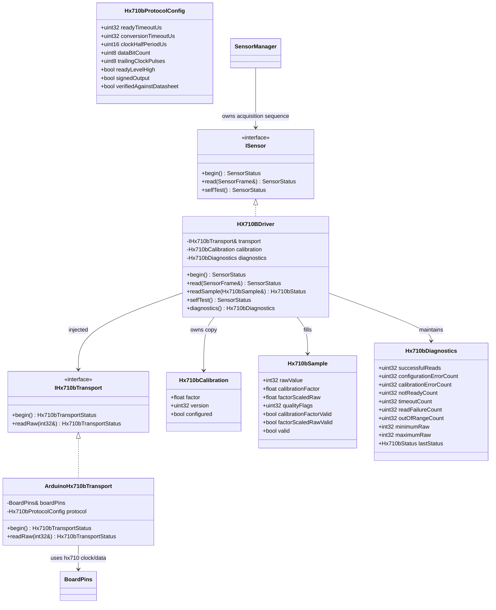

# HX710B driver

## Class diagram

## Scope and physical-quantity boundary

The driver exposes the ADC converter raw count, optional calibration factor,
factor-scaled raw count, read quality, and diagnostics. It has no transducer
type, physical measurand, engineering unit, physical range, or pressure/load
conversion. `factorScaledRaw` means only `rawValue * calibrationFactor`; it
must not be treated as a calibrated engineering measurement. The driver never
writes `SensorFrame::hx710bCalibratedValue`.

This follows the system documents: the transducer, wiring, zero/span, range and
measurand have not been selected. Do not feed this channel into a physical
feature, model, or risk policy until the transducer and calibration evidence
are reviewed and the data contract is updated.

## Transport and configuration

`ArduinoHx710bTransport` reads the clock/data pins from `BoardPins::hx710`.
There are no driver-local GPIO assignments. Its protocol must be explicitly
configured with finite ready and conversion timeouts, clock half-period, bit
count, trailing clock pulses, ready polarity, and signedness. `begin()` refuses to touch pins
unless both pins are assigned and distinct and
`verifiedAgainstDatasheet` is true. These settings must be confirmed for the
selected HX710B module and operating mode; they are not production defaults.
The read waits for the configured ready level using a wrap-safe timeout, then
shifts the configured number of bits and applies sign extension only if
configured. Both ready polling and conversion clocking have explicit bounded
timeouts; the polling and clocking path is synchronous and belongs in task
context, never an ISR.

Calibration is optional so raw acquisition and diagnostics remain available
before transducer selection. When configured, a finite nonzero factor and
nonzero calibration version are required for the factor to be marked valid.
Invalid/unset calibration does not suppress a valid raw conversion; it is
reported in quality flags and diagnostics. A configured valid factor produces
`factorScaledRaw` without assigning it a physical unit.

## Diagnostics and frame integration

`Hx710bDiagnostics` maintains saturating success, not-ready, conversion-timeout,
transport failure, configuration-error, calibration-error, and range-error
counters, last status,
calibration-factor availability, and observed raw min/max. Quality flags
distinguish valid raw data, valid factor, unavailable calibration, invalid
calibration, valid factor-scaled raw output, and factor-scaling overflow. Raw
zero is permitted when the sample validity flag is true.

The `ISensor` adapter writes raw count, optional factor/version and
factor-scaled raw values into `SensorFrame`; it leaves the legacy
`hx710bCalibratedValue` field untouched. `SensorManager` forwards only these
raw/factor outputs and does not create physical units. Diagnostics are
available from the driver instance and should be collected by the owning
diagnostics task. One `TaskSensor` owner is expected; no internal mutex is
used.
