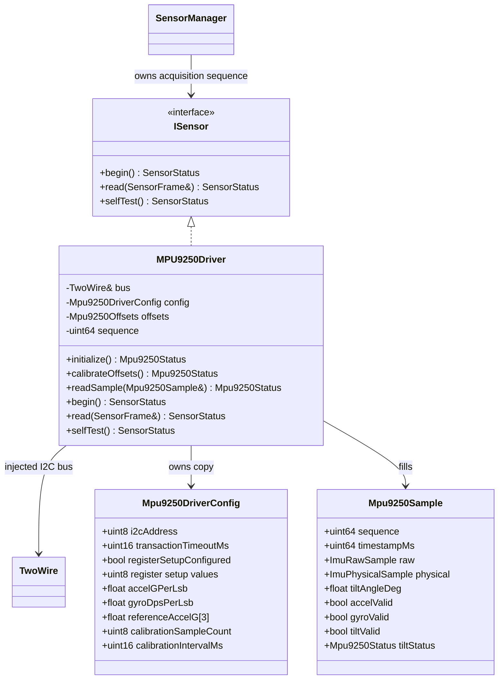

# MPU9250 driver

## Class diagram

## Contract and lifecycle

- Construct the driver with the already selected Arduino `TwoWire` instance and
  an explicitly populated `Mpu9250DriverConfig`. The driver does not initialize
  GPIOs or select SDA/SCL pins. Those belong to BSP/board integration.
- `initialize()` validates the configuration, applies the requested transaction
  timeout, optionally checks the configured `WHO_AM_I` value, and writes the
  explicitly supplied power, filter, sample divider, and full-scale register
  values. `registerSetupConfigured` must be set after the integrator has
  reviewed the complete register set. Identity checking is enabled by default;
  the expected identity remains caller-supplied. It does not choose unresolved
  hardware settings.
- `calibrateOffsets()` samples a stationary sensor. It computes gyro zero-rate
  offsets as the per-axis means and accelerometer offsets as the measured means
  minus the configured reference gravity vector converted to raw counts. The
  caller must position the unit in the documented reference pose and provide
  calibration settings after those are approved. Offsets are RAM-only.
- `begin()` runs initialization and calibration. Consequently it can block for
  the configured calibration duration and must be called during controlled
  sensor-task startup, not from an interrupt.
- `readSample()` returns raw counts, calibrated acceleration in g, calibrated
  angular rate in degrees/s, sequence and monotonic timestamp. Fixed-size
  buffers are used; there is no dynamic allocation.
- `read(SensorFrame&)` adapts the sample for the existing `ISensor`/
  `SensorManager` path. The driver is intended to have one owner (`TaskSensor`);
  it has no internal lock. I2C errors are exposed through `lastStatus()`, while
  `SensorStatus` indicates whether the acquisition itself was valid.

## Explicitly unresolved tilt behavior

The documents list `tilt_roll_deg` and `tilt_pitch_deg`, but leave the feature
formula, reference pose, axis/mounting transform and filtering method open. The
requested scalar `tiltAngleDeg` is therefore only a placeholder: it remains
invalid, and `Mpu9250Sample::tiltStatus` is `TiltCalculationPending`. The
implementation must not invent a scalar definition or treat its initialized
zero as a reading. Once the contract is approved, implement
`calculateTiltAngle()` and update the sensor feature/validity mapping together.

The I2C address, bus speed and electrical/pull-up review, scale factors, register
settings, sample rate, calibration pose/coefficients, and final MPU module
identity are also hardware/documentation inputs—not defaults in this driver.
Configuration currently must be supplied by the integration layer; all zero or
otherwise invalid required values fail validation instead of silently choosing
a value.
