# Rain sensor driver

## Class diagram

```mermaid
classDiagram
    class ISensor {
        <<interface>>
        +begin() SensorStatus
        +read(SensorFrame&) SensorStatus
        +selfTest() SensorStatus
    }
    class RainSensorDriver {
        -IAdcReader& adcReader
        -BoardPins& boardPins
        -RainSensorDriverConfig config
        -int32 samples[16]
        -uint64 sampleSum
        +begin() SensorStatus
        +read(SensorFrame&) SensorStatus
        +readSample(RainSensorSample&) RainSensorStatus
        +selfTest() SensorStatus
    }
    class IAdcReader {
        <<interface>>
        +readRaw(pin, output) bool
    }
    class ArduinoAdcReader {
        +readRaw(pin, output) bool
    }
    class RainSensorDriverConfig {
        +uint16 adcMaximumCount
        +uint8 filterWindowSamples
        +RainCalibrationPoint calibrationPoints[2]
        +uint32 calibrationVersion
        +bool adcConfigurationVerified
        +bool wetnessSemanticsVerified
        +bool calibrationConfigured
    }
    class RainCalibrationPoint {
        +uint16 adcCount
        +float wetnessPercent
    }
    class RainSensorSample {
        +int32 rawAdcCount
        +float filteredAdcCount
        +float wetnessRelativePercent
        +uint8 filterSampleCount
        +uint32 qualityFlags
        +bool valid
    }
    class SensorManager
    class BoardPins

    ISensor <|.. RainSensorDriver
    IAdcReader <|.. ArduinoAdcReader
    RainSensorDriver --> IAdcReader : injected ADC source
    RainSensorDriver --> BoardPins : uses adc.rainSensor
    RainSensorDriver --> RainSensorDriverConfig : owns copy
    RainSensorDriver --> RainSensorSample : fills
    SensorManager --> ISensor : owns acquisition sequence
```

## Behavior

The ADC reader is shared with the soil moisture driver. The rain GPIO comes
from `BoardPins::adc.rainSensor`; no pin number or ADC scale is embedded in the
driver. `adcMaximumCount`, a finite moving-average window (maximum 16 samples),
ADC verification, wetness semantics verification, and the calibration version
must all be explicitly supplied before initialization succeeds.

Each successful ADC sample enters the fixed-size moving average. The average
uses the number collected during filter warm-up, with
`FilterWindowWarming` set until the configured window fills. The current raw
count is retained separately from the filtered count. ADC read errors and
out-of-range values clear the filter to avoid mixing stale history into
subsequent valid data.

Two calibration points map the filtered ADC count to a relative wetness
percentage using linear interpolation. ADC counts must be distinct and within
the configured ADC maximum; wetness values must be finite, distinct, and in
`[0, 100]`. Values outside the calibration interval clamp to the endpoint
wetness, and a corresponding clamp quality flag is set. ADC polarity is not
assumed.

## Quality and contract limits

`RainSensorSample::qualityFlags` and `SensorStatus::qualityFlags` use the
driver-local `RainQualityFlag` bit assignments in `RainSensorDriver.h`; they
indicate an in-range ADC reading, valid calibration, filter warm-up, and
endpoint clamping. A failed ADC conversion, out-of-range count, or invalid
calibration returns an explicit `RainSensorStatus` and an invalid sensor
status. Numeric zero is never used as a failure indication.

On success, the `ISensor` adapter provides `SensorFrame::rainRaw`,
`rainWetnessRelativePct`, and its explicit validity flag. It does not populate
`rainRateMmH`: a YL-83 plate does not provide calibrated rainfall rate or amount.
The sensor documents leave analog/digital mode, electrical ADC range, wetness
semantics, threshold/calibration, and sample-window parameters unresolved.
Therefore this driver requires verified configuration and supplies no hardware,
filter, or calibration defaults. This relative wetness percentage must not be
treated as mm/h or rainfall total.

As with the other acquisition drivers, `TaskSensor` should be the sole owner;
filter state has no internal mutex. Sample timing is controlled by the sensor
manager/task and is not guessed inside the driver.
