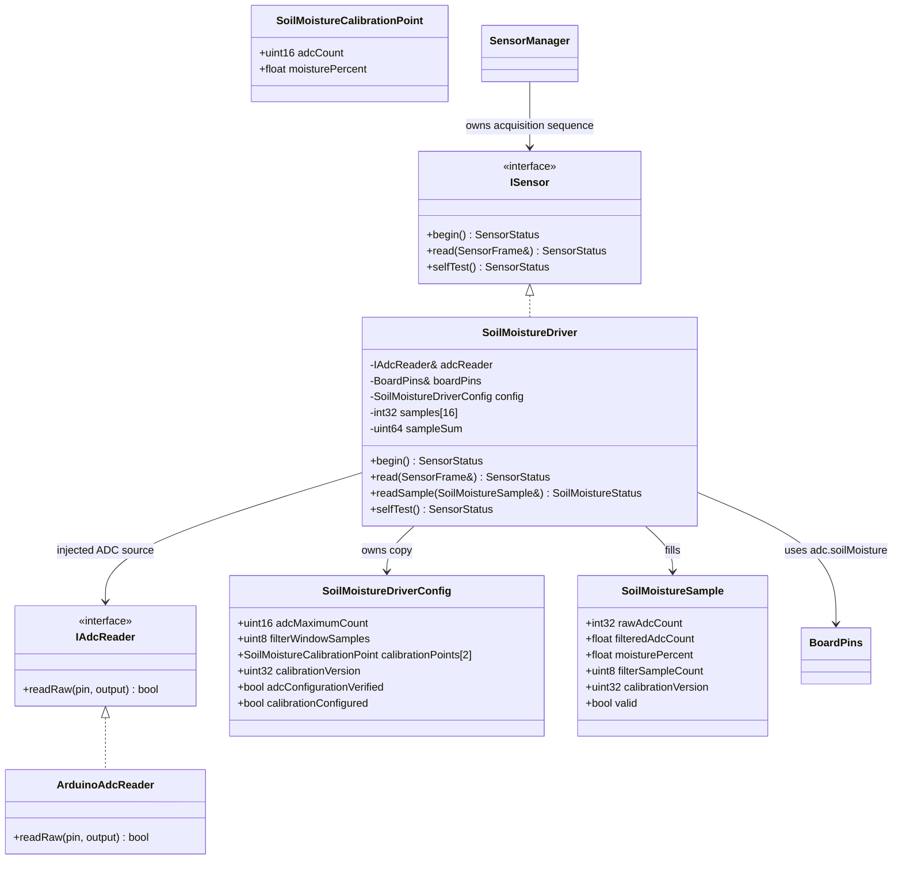

# Soil moisture driver

## Class diagram

## Acquisition and filtering

`ArduinoAdcReader` obtains one conversion through `analogRead()`. The selected
pin comes only from `BoardPins::adc.soilMoisture`; no GPIO number is embedded in
the driver. ADC resolution, attenuation, input range, and any board-specific ADC
setup must be configured and verified by the integration/BSP layer before
`begin()` can succeed. The driver accepts the verified ADC maximum count in
configuration and rejects negative or out-of-range readings.

Each successful sensor read adds one count to a fixed-size, configurable
moving-average window (maximum storage is 16 samples). Until the window fills,
the average uses the number of readings actually collected. `rawAdcCount`
retains the current conversion, while mapping uses `filteredAdcCount`. No
allocation, sleeps, or guessed sample interval are used; sample timing remains
owned by `SensorManager`/`TaskSensor`. A failed or invalid ADC conversion clears
the filter history to prevent stale readings from being mixed into recovery.

## Calibration and mapping

Supply two measured `SoilMoistureCalibrationPoint`s, each containing an ADC
count and its calibrated moisture percentage. Counts must be distinct and in
the configured ADC range; percentages must be distinct, finite, and in
`[0, 100]`. The driver linearly interpolates between the points and clamps
outside them to the closest endpoint percentage. The raw polarity is not
assumed, so either point may have the larger ADC count.

The documents say `soil_moisture_pct` is a percentage according to calibration
and explicitly warn not to interpret it as volumetric water content. They do
not prescribe calibration procedures, endpoints, ADC resolution, attenuation,
hardware input range, or calibration values. These must be established for the
selected sensor, substrate, and board; no example values are installed as
defaults. Set `calibrationConfigured`, `adcConfigurationVerified`, and a
nonzero calibration version only after those choices have been reviewed.

On success the `ISensor` adapter fills `SensorFrame::soilMoistureRaw`,
`soilMoisturePct`, and `calibrationVersion`. Errors are available from
`lastStatus()`; a failed sample returns invalid `SensorStatus` and does not
present initialized zero fields as measurements. The intended ownership is one
sensor task, so the driver does not add a mutex around its filter state.
